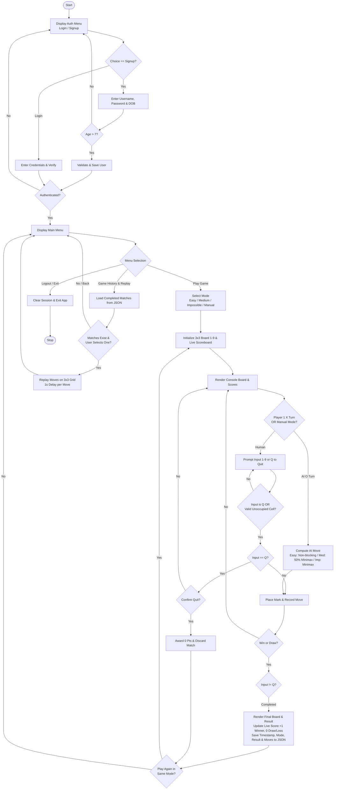
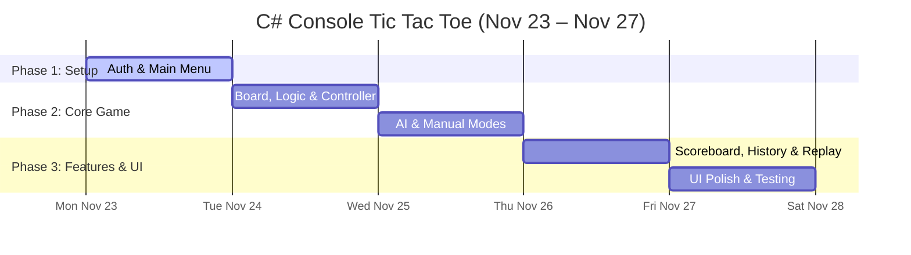

# High-Level Design (HLD) – Tic Tac Toe Console Application
 
## Document Information
 
| Field | Value |
|---|---|
| Title | Tic Tac Toe Application HLD |
| Author(s) | Dharanish |
| Date | 2026-11-23 |
| Status | Draft |
 
## Table of Contents
 
- [1. Problem Statement](#1-problem-statement)
- [2. Design Overview and Flow Diagram](#2-design-overview-and-flow-diagram)
- [3. Implementation Details](#3-implementation-details)
- [4. Security](#5-security)
- [5. Open Issues](#6-open-issues)
 
---
 
# 1. Problem Statement
 
The objective of this project is to develop a console-based Tic Tac Toe game application using C#. The application will allow users to create an account, log in, and play Tic Tac Toe in four different modes: Easy, Medium, Impossible, and Manual.
  
The application will maintain live scores for players and store completed match details, including the game mode, result, date, time, and moves. Users will also be able to replay their previous matches.
 
The main goal is to provide a simple, user-friendly gaming experience with proper user authentication, different computer difficulty levels, score management, and game history.
 
## Project Objectives
 
- Provide Login and Signup functionality.
- Support four different game modes.
- Maintain real-time scores during gameplay.
- Allow users to quit an active match.
- Store match details.
- Allow users to view and replay previous matches.
- Provide proper input validation and error messages.
 
# 2. Design Overview and Flow Diagram
 
The application follows a simple modular structure. Each module is responsible for a particular functionality, making the application easy to understand, maintain, and test.
 
Since this is a console-based application, all user interactions will happen through the console. User details, scores, and match history will be stored in local JSON files.
 
## 2.1 System Architecture
 



 
## 2.2 Application Flow
 
1. When the application starts, the user will be redirected to the Login or Signup section.
2. Existing users can log in using their username and password.
3. New users can create an account using the Signup option.
4. After successful authentication, the main menu will be displayed.
5. The user can select a game mode, view the scoreboard, check game history, or log out.
6. Based on the selected game mode, the game controller starts a new match.
7. The game logic manages player turns, validates moves, checks winning conditions, and updates the board.
8. After the match is completed, the result and match details are saved in JSON files.
9. The user can choose to play again in the same mode or return to the main menu.
10. From the Game History section, users can select and replay their previous completed matches.
 
# 3. Implementation Details
 
## 3.1 Components and Responsibilities
 
# C# Console Tic Tac Toe - Architecture & Project Timeline

## 1. System Modules

| Component | Responsibility |
| :--- | :--- |
| **Authentication Module** | Handles user Login, Signup, and Logout with JSON/file persistence. |
| **Main Menu Module** | Displays the available application options and manages navigation. |
| **Game Controller** | Manages the overall gameplay loop, mode selection, and player turns. |
| **Game Board Module** | Displays and updates the 3×3 Tic Tac Toe board in the console. |
| **Game Logic Module** | Checks valid moves, winning conditions, draws, and mid-game quits. |
| **Move Strategy Module** *(Consolidated Modes)* | Implements `IMoveStrategy` across 4 modes:<br>• **Easy Mode:** Random moves while avoiding blocking the player's immediate winning line.<br>• **Medium Mode:** Alternates between Minimax and random moves (50% probability).<br>• **Impossible Mode:** Full Minimax algorithm ensuring the AI never loses.<br>• **Manual Mode:** Local 2-player input on the same console. |
| **Scoreboard Module** | Tracks and displays live session scores (+1 win, 0 draw/loss). |
| **Match Persistence & Replay Module** | Saves completed match details (timestamp, mode, result, moves) to JSON and replays previous matches move-by-move with a 1s delay. |
| **Enhancement Module** | Improves console UI with colors, box-drawing characters, and user-friendly prompts. |

---

## 2. 5-Day Development Schedule (Nov 23 – Nov 27)

| Day & Date | Modules Covered | Key Tasks & Deliverables | Est. Duration |
| :--- | :--- | :--- | :--- |
| **Day 1**<br>Mon, Nov 23 | • Authentication Module<br>• Main Menu Module | • Build user registration & login validation.<br>• Set up JSON storage for user credentials.<br>• Create the main navigation loop and session logout. | **4 hrs** |
| **Day 2**<br>Tue, Nov 24 | • Game Board Module<br>• Game Logic Module<br>• Game Controller | • Render the 3×3 grid (cells 1–9) in the console.<br>• Implement move validation, win/draw checks, and `Q` to quit.<br>• Build the core turn-switching loop. | **6.5 hrs** |
| **Day 3**<br>Wed, Nov 25 | • Move Strategy Module<br>*(Manual, Impossible, Medium, Easy)* | • Implement 2-player local input (Manual).<br>• Code the recursive Minimax algorithm (Impossible).<br>• Add 50% Minimax/random split (Medium) and non-blocking random logic (Easy). | **7.0 hrs** |
| **Day 4**<br>Thu, Nov 26 | • Scoreboard Module<br>• Match Persistence & Replay Module | • Track live session scores.<br>• Serialize timestamp, mode, result, and move list to JSON.<br>• Build the step-by-step match replay feature. | **6.0 hrs** |
| **Day 5**<br>Fri, Nov 27 | • Enhancement Module<br>• Final Testing & QA | • Add console colors (`X` vs `O`), borders, and clean screen clears.<br>• Test edge cases (invalid inputs, empty JSON files, mid-game quits). | **5.0 hrs** |

---

## 3. Visual Timeline (Gantt Chart)



 
## 3.2 Game Rules and Logic
 
The game will follow standard Tic Tac Toe rules.
 
- The board consists of a 3×3 grid with nine cells.
- Player 1 will always use X and make the first move.
- Player 2 or the computer will use O.
- Players must enter a cell number between 1 and 9.
- A player cannot place a mark in an already occupied cell.
- Three matching marks in a horizontal, vertical, or diagonal line result in a win.
- If all nine cells are occupied without a winner, the match ends in a draw.
 
### Game Modes
 
**1. Easy Mode**
 
- The computer selects a random available cell.
- It avoids selecting a cell that blocks the player's immediate winning line.
- If no non-blocking move is available, it selects from the remaining valid cells.
 
**2. Medium Mode**
 
- The computer alternates between optimal Minimax moves and random moves.
- Each move has a 50% probability of using either strategy.
- This provides a balanced gameplay experience.
 
**3. Impossible Mode**
 
- The computer uses the Minimax algorithm to evaluate possible moves.
- It selects the best available move.
- The computer guarantees that the player cannot win. The result will be either a computer victory or a draw.
 
**4. Manual Mode**
 
- Two players play on the same console.
- Player 1 uses X, and Player 2 uses O.
- Both players enter their moves one after another.
 
## 3.3 Data Storage
 
The application will use local JSON files to store user information, scores, and match history.
 
No external database is required.
 
The following files will be maintained:
 
**1. Users.json**
 
Stores registered user details.
 
Example:
 
```json
[
  {
    "UserId": "u_001",
    "Username": "player1",
    "DateOfBirth": "2002-05-14",
    "PasswordHash": "hashed_password_here",
    "CreatedAt": "2026-11-23T10:20:00Z",
    "Stats": {
      "GamesPlayed": 12,
      "Wins": 7,
      "Losses": 3,
      "Draws": 2
    }
  }
]

```
 
**2. Scores.json**
 
Stores the cumulative scores of users.
 
Example:
 
```json
[
  {
    "Username": "player1",
    "Player1Score": 5,
    "Player2Score": 3
  }
]
```
 
**3. GameHistory.json**
 
Stores completed match information.
 
Example:
 
```json
[
  {
    "Username": "player1",
    "GameMode": "Easy",
    "Result": "Win",
    "DateTime": "2026-11-23 10:30:00",
    "Moves": [1, 5, 2, 8, 3]
  }
]
```
  
## 3.4 Technology Choices
 

| Technology | Purpose |
|---|---|
| **C#** | Main programming language. |
| **.NET** | Runtime environment for executing the application. |
| **Console Application** | Provides the base execution environment for user interaction. |
| **Spectre.Console** | Beautifies the console UI with colored text, tables, panels, ASCII banners, and interactive selection menus. |
| **JSON** | Stores user details, scores, and match history locally. |
| **System.Text.Json** | Handles JSON serialization and deserialization. |
| **Minimax Algorithm** | Used for Impossible Mode and optimal computer moves in Medium Mode. |

 
These technologies are suitable because they are simple, lightweight, and sufficient for developing a console-based game.
 
## 3.5 Performance and Scalability
 
The application is designed for individual users playing through a console.
 
- The 3×3 game board requires very little processing time.
- The Minimax algorithm can efficiently evaluate all possible Tic Tac Toe moves.
- JSON files are sufficient for storing user details, scores, and match history.
- Only one user account will be active during a console session.
 
Since the application is designed for local usage, large-scale server infrastructure is not required.
 
## 3.6 Input Validation and Error Handling
 
The application will validate all user inputs before processing them.
 
- Invalid username or password will display an appropriate error message.
- Duplicate usernames will not be allowed during Signup.
- Invalid cell numbers will be rejected.
- Already occupied cells cannot be selected again.
- Invalid characters will display a warning message.
- Entering Q during a match will immediately quit the active match after confirmation.
- File-related errors will be handled without unexpectedly crashing the application.
 
The board will remain unchanged when an invalid move is entered.
 
## 3.7 Testing Strategy
 
The application will be tested at different levels to ensure that all functionalities work correctly.
  
- Test the complete application flow from Signup to Logout.
- Play matches in all four game modes.
- Test quitting a match during gameplay.
- Test replaying previous matches.
- Test invalid inputs and unexpected user actions.
 
# 4. Security
 
Security is important because the application maintains user accounts and passwords.
 
## 4.1 Authentication and Authorization
 
- Users must log in using valid credentials before accessing the main menu.
- New users must register through the Signup section.
- Duplicate usernames will not be allowed.
- Only one user account can be logged in during a console session.
- Users can log out through the main menu.
 
## 4.2 Data Handling
 
- User information, scores, and match history will be stored in local JSON files.
- Passwords will be stored as secure password hashes instead of plain text.
- Access to local data files will be restricted through appropriate file permissions.
- Sensitive information will not be displayed unnecessarily in the console.
 
## 4.3 Input Validation
 
- Username and password inputs will be validated during Signup and Login.
- Game moves must contain valid cell numbers between 1 and 9.
- Occupied cells cannot be selected.
- Invalid characters and unexpected inputs will be handled safely.
 
## 4.4 Threats and Mitigations
 
| Possible Threat | Mitigation |
|---|---|
| Unauthorized Login | Validate credentials before granting access. |
| Password Exposure | Store password hashes instead of plain-text passwords. |
| Invalid User Input | Validate all inputs before processing. |
| Data Modification | Restrict access to local JSON files. |
| Accidental Data Loss | Handle file operations carefully and validate stored data. |
 
## 4.5 External Dependencies
 
The application uses built-in .NET libraries and  JSON storage. No external services or third-party APIs are required.
 
# 5. Open Issues
 
 
These points can be finalized before or during implementation based on testing and project requirements.
 
---
 