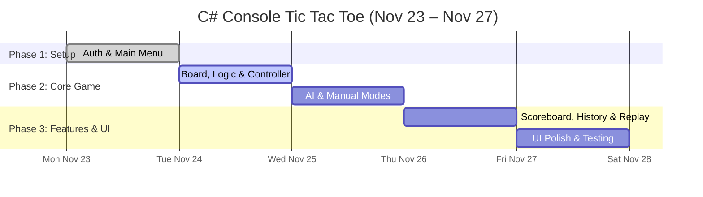

# C# Console Tic Tac Toe — Project Plan

## 1. System Modules

| Component | Responsibility |
| :--- | :--- |
| **Authentication Module** | Handles user Login, Signup (with age > 7 verification), and Logout with JSON persistence. |
| **Main Menu Module** | Displays the available application options and manages navigation via Spectre.Console. |
| **Game Controller** | Manages the overall gameplay loop, mode selection, player turns, and quit confirmation. |
| **Game Board Module** | Displays and updates the styled 3×3 Tic Tac Toe board in the console. |
| **Game Logic Module** | Checks valid moves, winning conditions, draws, and mid-game quits. |
| **Move Strategy Module** *(Consolidated Modes)* | Implements `IMoveStrategy` across 4 modes: • **Easy Mode:** Random moves while avoiding blocking the player's immediate winning line. • **Medium Mode:** Alternates between Minimax and random moves (50% probability). • **Impossible Mode:** Full Minimax algorithm ensuring the AI never loses. • **Manual Mode:** Local 2-player input on the same console. |
| **Scoreboard Module** | Tracks and displays live session scores (+1 win, 0 draw/loss) alongside lifetime user stats. |
| **Match Persistence & Replay Module** | Saves completed match details (timestamp, mode, result, moves) to JSON and replays previous matches move-by-move with a 1s delay. |
| **Enhancement Module** | Improves console UI with Spectre.Console colors, tables, panels, and user-friendly prompts. |

---

## 2. 5-Day Development Timeline (Nov 23 – Nov 27)

| Day & Date | Modules Covered | Key Tasks & Deliverables | Est. Duration |
| :--- | :--- | :--- | :--- |
| **Day 1** Mon, Nov 23 | • Authentication Module • Main Menu Module | • Build user registration (with DOB/age > 7 check) & login validation. • Set up `users.json` storage. • Create the Spectre.Console main navigation loop and logout. | **5.5 hrs** |
| **Day 2** Tue, Nov 24 | • Game Board Module • Game Logic Module • Game Controller | • Render the 3×3 grid (cells 1–9) using Spectre.Console. • Implement move validation, win/draw checks, and `Q` quit confirmation. • Build the core turn-switching loop. | **6.5 hrs** |
| **Day 3** Wed, Nov 25 | • Move Strategy Module *(Manual, Impossible, Medium, Easy)* | • Implement 2-player local input (Manual). • Code the recursive Minimax algorithm (Impossible). • Add 50% Minimax/random split (Medium) and non-blocking random logic (Easy). | **7.0 hrs** |
| **Day 4** Thu, Nov 26 | • Scoreboard Module • Match Persistence & Replay Module | • Track live session and persistent user scores. • Serialize timestamp, mode, result, and move list to `matches.json`. • Build the 1-second delay step-by-step match replay. | **6.0 hrs** |
| **Day 5** Fri, Nov 27 | • Enhancement Module • Final Testing & QA | • Polish console colors (`X` vs `O`), borders, and clean screen clears. • Test edge cases (invalid keys, empty JSON files, quit confirmation). | **5.0 hrs** |

---

## 3. Visual Timeline (Gantt Chart)

